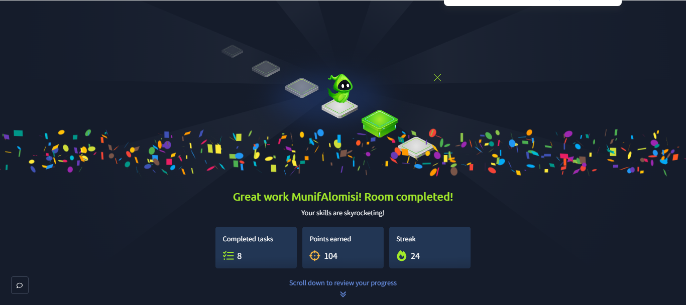

# AI-Assisted SOC Investigation — Evidence-Based Elastic Security Case Study

**Author:** Munif Alomisi  
**Training environment:** [TryHackMe — AI in the Modern SOC](https://tryhackme.com/room/aiinthemodernsoc)  
**Lab completion:** **100% (8 tasks)** — completion screen captured on 19 November 2026 (local time)  
**Focus:** SOC alert triage · Windows/Sysmon process ancestry · KQL/ES|QL · AI-output validation · Tier 2 escalation

> **Scope:** A controlled, fictional TryHackMe training environment. All hosts, users, IPs, and case identifiers below are **lab artifacts**, not claims about a real enterprise compromise. The screenshots are taken from the learner's own session. This repository is an independent learning case study, not an official TryHackMe or Elastic publication.

## Executive summary

The lab presented a **medium-severity** Elastic Security alert, **“Encoded PowerShell started by Windows Script Host”**, for the finance workstation `FIN-LT-0142`. I investigated source telemetry, reconstructed key process relationships, checked an associated `curl.exe` outbound connection, then independently validated a short AI-prepared case observation against the cited Sysmon event. An analyst observation and a Tier 2 handover were prepared in the case workflow.

**Principal outcome:** The AI observation that `explorer.exe` started `wscript.exe` in the context of `CASTELLANE\owen.farrelly` was **Supported** by native event fields. This **does not** establish that the overall activity was malicious or authorized. The purpose of the outbound connection and any transferred content remain unresolved.

## Evidence snapshot

| Item | Result | Evidence / qualification |
|---|---|---|
| Elastic case | `CC-CASE-0913` | Training case; severity Medium |
| Detection | `Encoded PowerShell started by Windows Script Host` | Confirmed by TryHackMe grading and Elastic screen |
| Endpoint | `FIN-LT-0142` | Correlated host |
| `wscript.exe` | 2026-08-07 07:42:31 UTC | Process-start timestamp |
| `powershell.exe` | 2026-08-07 07:42:43 UTC | **12-second** difference |
| PowerShell parent PID | `6064` | Confirmed in room |
| PowerShell parent entity ID | `de65ceea-0b45-5362-824c-12abe5e33edf` | Copied from native event |
| Native `wscript.exe` parent | `explorer.exe` | Verified in Discover |
| Native user | `CASTELLANE\owen.farrelly` | Verified in Discover |
| Associated network process | `curl.exe` | ES\|QL network event |
| Connection | `10.40.20.77:443` / `tcp` | 2026-08-07 07:43:03 UTC; verified screenshot |
| AI observation verdict | **Supported** | Only the *specific* parent/user observation; not entire alert disposition |
| AI triage run | `CC-TRIAGE-20260829-0001` | Copied from case comment |
| Lookup count | `4` | Run receipt |
| Room result | **100% / 8 tasks** | Completion screenshot |

## Investigation workflow

1. **Alert triage.** Locate the Elastic detection for `FIN-LT-0142` and capture the precise rule name.
2. **Process ancestry.** Correlate `wscript.exe` and `powershell.exe` in Timeline using timestamps and native process IDs; establish a 12-second interval.
3. **Network correlation.** Use ES|QL to find the associated `curl.exe` connection to `10.40.20.77:443/TCP`.
4. **AI output review.** Open case `CC-CASE-0913`, review the *AI-prepared case note*, and independently reopen its cited source document in Discover.
5. **Evidence validation.** Confirm `process.parent.name = explorer.exe` and `user.name = CASTELLANE\owen.farrelly` in the native `wscript.exe` event; rate that specific AI statement **Supported**.
6. **Analyst documentation and escalation.** Write a separate analyst observation, add the `tier2-review` tag, and prepare a bounded Tier 2 handover that leaves substantive questions open.

**Important evidentiary distinction:** The lab guidance describes `explorer.exe → wscript.exe → powershell.exe → curl.exe`. The parent/user relation and `wscript.exe`/`powershell.exe` timing are independently evidenced in screenshots. The network event is separately evidenced; readers should not assume every inter-process parent-child edge was reverified in the published screenshot set. See [Evidence ledger](reports/evidence-ledger.md).

## Screenshots from the practical session

| Screenshot | What it demonstrates |
|---|---|
| [01 — Completion](screenshots/01-completion.png) | Completed room |
| [02 — Elastic Security](screenshots/02-elastic-security.png) | Browser-based Elastic UI |
| [03 — Triage](screenshots/03-alert-answers.png) | Graded alert/rule facts |
| [04 — Parent timestamp](screenshots/04-process-correlation.png) | Native `wscript.exe` timestamp |
| [05 — Case](screenshots/05-ai-case-note.png) | Elastic case and AI note |
| [06 — Parent process](screenshots/06-parent-process-evidence.png) | `process.parent.name` |
| [07 — User](screenshots/07-user-evidence.png) | `user.name` |
| [08 — Network](screenshots/08-network-evidence.png) | `curl.exe`, IP, port, transport |
| [09 — Analyst observation](screenshots/09-analyst-observation.png) | Saved SOC analyst comment |
| [10 — Tier 2 tag](screenshots/10-tier2-tag.png) | `tier2-review` tag |

## Repository files

- [Investigation report](reports/investigation-report.md) — technical narrative and limits
- [Evidence ledger](reports/evidence-ledger.md) — claim-to-source mapping
- [AI validation](reports/ai-validation.md) — human-in-the-loop verification
- [Tier 2 handover](reports/tier2-handover.md) — professional handoff example
- [KQL searches](queries/kql.md) and [ES|QL queries](queries/esql.md) — reproducible search templates
- [Lessons learned](reports/lessons-learned.md)
- [LinkedIn launch post](linkedin/linkedin-post.md) — copy-ready post

## Responsible publication

The data originates in a contained exercise. Do not equate a suspicious detection with proven compromise, exfiltration, malicious intent, or successful execution of attacker commands. No exploit code or credentials are published. Source artifacts that were **not** captured, such as the native `winlog.record_id`, are explicitly marked **not verified**.

**Tools:** Elastic Security, Kibana Discover, Timeline, Windows Sysmon telemetry, KQL, ES|QL.  
**Credits:** TryHackMe for the lab; Elastic for Elastic Security/Kibana. Independent write-up by **Munif Alomisi**.
